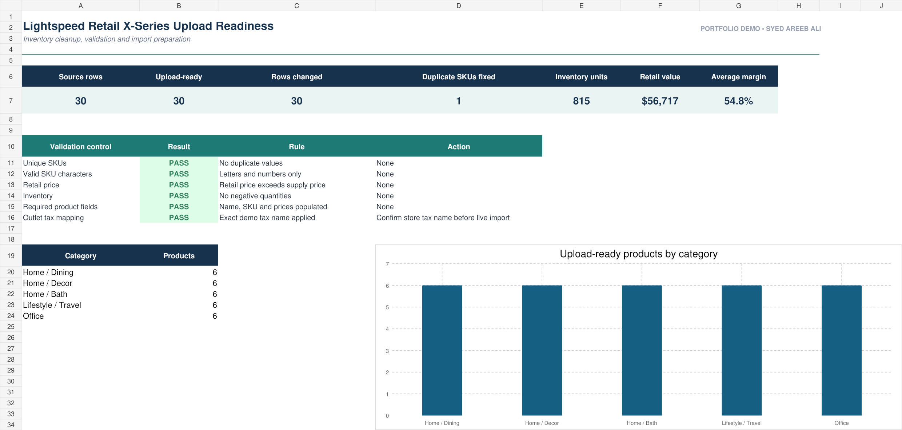

# Lightspeed Retail X-Series Upload Readiness System

An inventory-cleaning and upload-preparation workflow designed for Lightspeed Retail X-Series product imports.

## Challenge

Retail inventory exports often contain duplicate SKUs, inconsistent descriptions, invalid characters, missing values, negative inventory, and pricing issues. These problems can block an import or create unreliable product records.

## Solution

This project provides a structured workbook that separates raw data from cleaned output, records each correction, and prepares a final CSV for import testing.

## Included files

- `Lightspeed_X_Series_Inventory_Upload_Portfolio.xlsx` — five-sheet working workbook.
- `Lightspeed_X_Series_Upload_Ready.csv` — cleaned 30-product upload dataset.
- `Lightspeed_X_Series_Portfolio_Preview.png` — project presentation visual.

## Workbook modules

1. **QC Dashboard** — summary of validation results and readiness.
2. **Clean Upload** — normalized records prepared for export.
3. **Raw Inventory** — original demonstration dataset.
4. **Cleaning Log** — transparent before/after correction history.
5. **Field Guide** — column definitions and handover notes.

## Checks represented

- Duplicate and malformed SKU detection
- Missing product-description cleanup
- Negative-inventory checks
- Pricing correction and normalization
- Upload-column consistency
- Formula-error scan with zero matches

> Before a live store import, replace demonstration outlet, tax, and inventory column names with the merchant account's exact values and test a small batch first.

[View the related Fiverr service](https://www.fiverr.com/nextgencreator2/clean-inventory-csv-and-prepare-lightspeed-retail-x-series-product-uploads)
