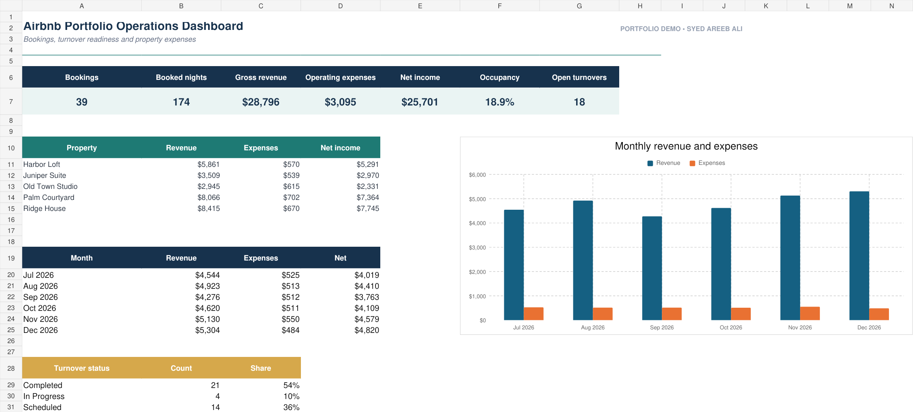

# Airbnb Host Operations Dashboard

A multi-property spreadsheet system for booking oversight, expense tracking, cleaning schedules, and guest turnover coordination.

## Challenge

Hosts and property managers frequently track reservations, cleaners, expenses, and property details in disconnected files. This makes upcoming turnovers easy to miss and reduces visibility into operating costs.

## Solution

The workbook brings the entire operating workflow into one dashboard with structured registers, editable assumptions, dropdown-ready fields, visual alerts, and monthly reporting.

## Included files

- `Airbnb_Host_Operations_Portfolio.xlsx` — six-sheet operational workbook.
- `Airbnb_Operations_Portfolio_Preview.png` — project presentation visual.

## Workbook modules

1. **Dashboard** — key totals, status indicators, and monthly chart.
2. **Bookings** — reservation and guest details.
3. **Turnovers** — cleaning assignments and readiness status.
4. **Expenses** — categorized property expenses.
5. **Properties** — editable property assumptions.
6. **Read Me** — setup and usage instructions.

## Demonstration scale

- 5 properties
- 42 booking records
- 39 turnover records
- 54 expense records
- 300 prepared rows in each operating register
- Formula-error scan with zero matches

[View the related Fiverr service](https://www.fiverr.com/nextgencreator2/create-a-custom-airbnb-expense-cleaning-and-guest-turnover-spreadsheet)
